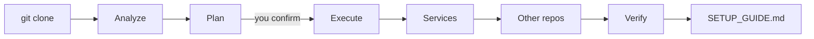

# Usage

Everything gclone can do, and the flags that control it. New to gclone? Start with the
[install guide](INSTALL.md), then come back.

## Getting started

Clone and set up a project in one step:

```bash
gclone someone/app                      # GitHub shorthand
gclone https://github.com/someone/app.git my-folder
gclone ./local-repo copy-of-it          # a local path also works
```

Look before it does anything beyond cloning:

```bash
gclone someone/app --dry-run
```

Set up a repository you already cloned, then check that it runs:

```bash
cd app
gclone setup
gclone verify
gclone status      # what was done, what failed, what is out of date
```

**What happens behind the scenes**

1. `git clone` (git submodules are fetched after asking).
2. The repository is analyzed: package manager, Node version, env files, compose files,
   databases, other repositories.
3. It prints a **plan** and asks `Run this plan? [Y/n]`.
4. It creates `.env`, starts compose database services, and installs dependencies.
5. For any database that is still missing it asks what to do. The default is to skip.
6. For any other repository the project needs it asks before cloning. The default is no.
7. It asks whether to run the verification. The default is no.
8. It writes `SETUP_GUIDE.md`.

The generated guide tells you what to do next, for example:

```markdown
**Set these first** (empty or placeholder, the app will likely fail without them):

- `STRIPE_API_KEY`: placeholder value, replace it with a real one. Note from the example file: Create one in the Stripe dashboard

**Works on defaults, change for real use:**

- `JWT_SECRET`: secret, fine for local use, replace before sharing or deploying

**Read by the code but not in the example file**: `SMTP_HOST`
```

## Commands

| Command | What it does |
|---|---|
| `gclone <repo> [directory]` | Clone, analyze, ask, set up, write the guide |
| `gclone setup [directory]` | The same for a repository you already cloned |
| `gclone verify [directory]` | Build it, start it, check that it answers. Exit code 1 when not ready |
| `gclone status [directory]` | What gclone did here, what failed, what is out of date. Exit code 1 when a step or the last verification failed |
| `gclone doctor [directory]` | Can this machine run it? Changes nothing. [See below](#check-a-machine-first-gclone-doctor) |
| `gclone export devcontainer [directory]` | Write a `.devcontainer/`. See [Dev Containers](DEVCONTAINER.md) |

## Flags

gclone has **no configuration file**. Behaviour is controlled with flags.

| Flag | Meaning |
|---|---|
| `-n`, `--dry-run` | Clone and analyze, show the plan, run nothing else |
| `-y`, `--yes` | Skip the `Run this plan?` and git submodule confirmations (database, Docker, other-repository and verify prompts still apply) |
| `--ignore-scripts` | Pass `--ignore-scripts` to the package manager |
| `--no-install` | Skip installing dependencies |
| `--no-services` | Do not start database services from compose files |
| `--install-services` | Take the first safe option to start a missing database without asking. It never installs Docker itself |
| `--clone-deps` | Clone and set up other repositories the project needs without asking |
| `--no-deps` | Do not look for other repositories |
| `--verify` | Run the verification after setup without asking |
| `--no-build` | Skip the build step when verifying |
| `--resume` | With `setup`: skip install steps that already succeeded at the same commit |
| `--run-project-setup` | Also run the setup command the repo ships (`make setup`, `bin/setup`, a justfile recipe) as the last step. Never implied by `--yes` or `--ci` |
| `--ci` | For scripts and CI: never ask or read the terminal (every question is answered no), implies `--yes`, exit code 1 when a step or the verification fails. Add `--verify` to verify as well |
| `--json` | Print one JSON result on standard output, all other messages go to standard error. With `status`, print the recorded state |
| `--timeout=SECONDS` | How long verify waits for the app to listen (default 60) |
| `-v`, `--version` / `-h`, `--help` | Version / help |

For scripts and CI see [Scripts and CI](CI.md).

## Check a machine first: `gclone doctor`

`gclone doctor [directory]` answers one question and changes nothing: can this machine run
this project? It reads the folder the way `setup` does and then checks:

- **Tools** the stacks need (git, node and the package manager, go, java and maven or gradle,
  python and its package manager or `venv` support, flutter), with their versions.
- **Project warnings** gclone already found, such as a Node, Go, Java or Python version that is
  older than the project asks for, or two apps that want the same port.
- **Services**: whether Docker is installed and running, and whether each database the
  project needs is already answering.
- **Ports** the apps want, and whether they are free.
- **Disk**: free space (a warning under 2 GB, a failure under 500 MB).

Each line is `[ok]`, `[warn]` or `[FAIL]`. The verdict is `READY`, `READY WITH WARNINGS` or
`NOT READY`, and the exit code is 1 only for `NOT READY`. A missing database or a stopped
Docker is a warning, because `gclone setup` can offer to start it. `--json` prints the same
result as JSON. It runs only version commands of tools (`node --version`, `docker info`), never
code from the project.

## The repository's own setup command

Many repositories ship their own setup: a `setup` (or `bootstrap`, `dev-setup`, `setup-dev`)
target in a `Makefile` or `justfile`, or a script such as `bin/setup`, `script/bootstrap` or
`scripts/setup.sh`. gclone finds these in the root and one folder down, lists them in the plan
and the guide, and does **not** run them, because they can run anything on your machine
(`install` and `init` targets are ignored on purpose: in a Makefile `install` usually copies a
program into the system).

`gclone setup --run-project-setup` adds the command as the last step, after dependencies are
installed, and you still confirm the plan. It is never switched on by `--yes` or `--ci`. Read
the file first. If the tool is missing (`make`, `just`), `gclone doctor` says so as a warning.

## How it works



| Component | Package | Job |
|---|---|---|
| CLI and flow | `internal/cli` | Argument parsing, `setupRepo`, prompts |
| Detection | `internal/analyze`, `internal/adapter/node`, `internal/adapter/golang`, `internal/adapter/java`, `internal/adapter/python`, `internal/adapter/flutter`, `internal/envfile`, `internal/compose` | Packages, package manager, Node version, env files, compose files |
| Plan and execute | `internal/plan` | Builds the list of steps, runs them |
| Services | `internal/services`, `internal/docker`, `internal/installer` | Needed databases, Docker states, install and start options |
| Other repositories | `internal/repos` | Finds, asks about and sets up dependent repositories |
| Verification | `internal/verify`, `internal/proc` | Build, start, port check, HTTP probe, process cleanup |
| Guide | `internal/guide` | Writes `SETUP_GUIDE.md` |

More detail for contributors is in [ARCHITECTURE.md](ARCHITECTURE.md).
